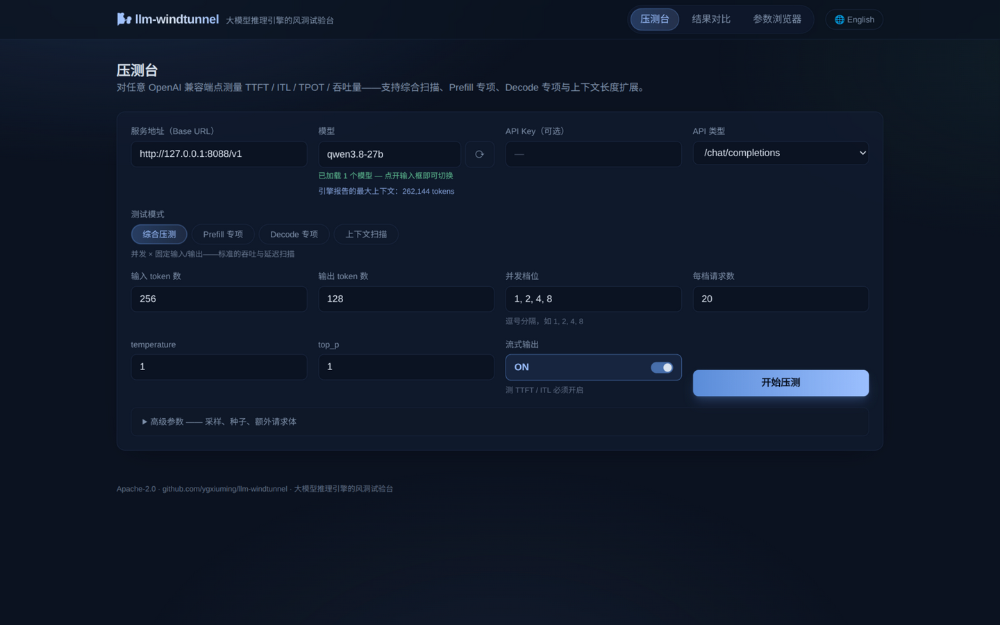
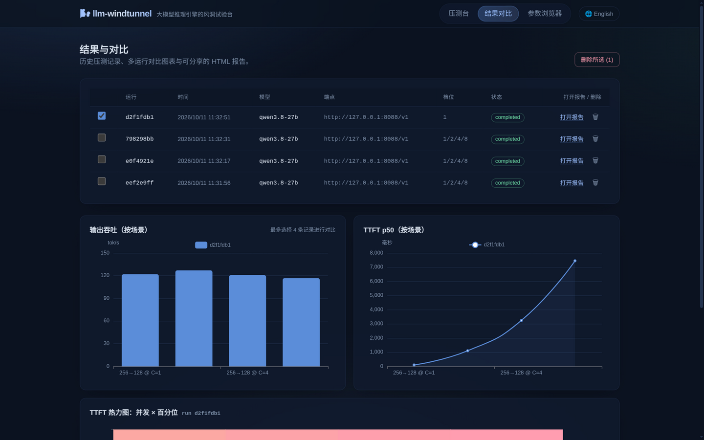
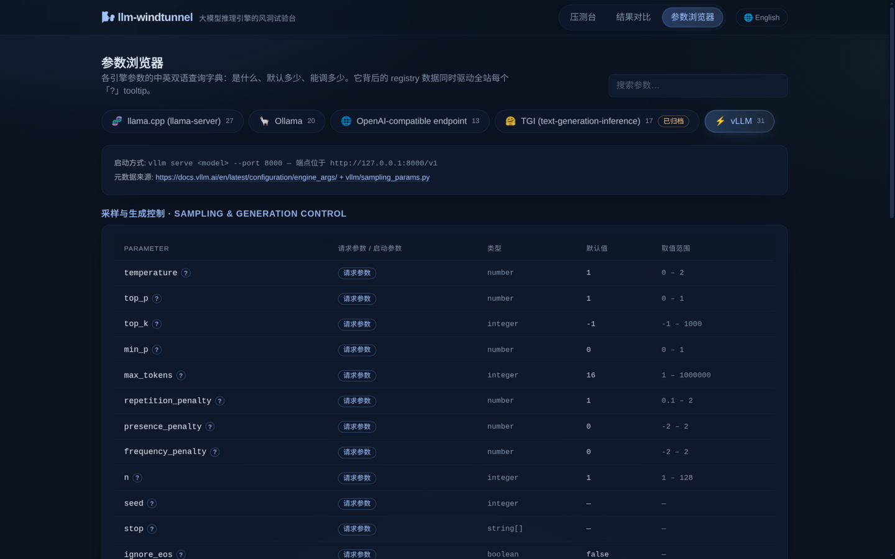

# 🌬️ llm-windtunnel

**大模型推理引擎的风洞试验台。**
一个工作台覆盖 vLLM、Ollama、llama.cpp、TGI 及任意 OpenAI 兼容端点的性能测试——
TTFT、ITL、TPOT、吞吐量、延迟百分位数——并且**每个参数都有中英双语的悬停解释**。

[English README](README.md) · [开源调研报告](docs/research/opensource-survey-2026-10.md)



| 结果对比 | 参数浏览器 |
|---|---|
|  |  |

---

## 为什么做这个

现有 LLM 基准工具大多是 CLI 优先、纯英文、绑定单一引擎。调优本地引擎时你不断在问：
*这个参数是干什么的？默认值多少？下一步调多少？*——然后手动重跑一遍基准。

llm-windtunnel 把答案直接放进界面：

- **参数浏览器** —— 各引擎全部参数（vLLM `EngineArgs`/`SamplingParams`、Ollama
  Modelfile、llama.cpp `llama-server`、TGI launcher）结构化为
  [版本化 YAML registry](registry/)，含双语描述、类型、默认值、取值范围、CLI flag。
  鼠标悬停 **?** 图标即可看到完整解释。
- **压测台** —— 对任意 OpenAI 兼容端点发起流式压测：并发档位扫描（C=1,2,4,8…）、
  完整百分位覆盖（P50/P90/P95/P99）、token 精确计数（服务端 `usage` 优先，本地
  tiktoken 兜底）。
- **结果对比** —— 历史记录 + 交互式图表（吞吐柱状图、TTFT 折线、并发×百分位热力图），
  每次运行可生成**单文件自包含 HTML 报告**，随时分享。
- **中/EN 一键切换** —— 整个界面（包括每条参数解释）即时切换。

## 快速开始

环境要求：**Node.js ≥ 20**（无需 Python）。

```bash
npm install          # 一次安装 server + web + shared 三个 workspace

# 开发模式：Fastify API 跑在 :8787，Vite 开发服务器跑在 :5173
npm run dev

# 生产模式：构建 SPA 后由单进程托管全部内容
npm run build
npm start            # → http://127.0.0.1:8787
```

打开 http://127.0.0.1:5173（开发）或 http://127.0.0.1:8787（生产），
进入「压测台」，填入你的引擎地址——例如 `http://127.0.0.1:8000/v1`（vLLM）、
`http://127.0.0.1:11434/v1`（Ollama）、`http://127.0.0.1:8080/v1`（llama.cpp）——
点击**开始压测**。模型列表会从 `GET /v1/models` 自动加载（点开输入框即可切换），
引擎报告的最大上下文也会自动显示。

### 四种测试预设（同一场景引擎驱动）

| 预设 | 做什么 | 得到什么 |
|---|---|---|
| **综合压测** | 并发 × 固定输入/输出 | 每个并发档的吞吐与延迟百分位 |
| **Prefill 专项** | 输入长度扫描，输出仅 1 token | 预填充 tok/s（对标 llama-bench `pp`） |
| **Decode 专项** | 极短输入 + 长输出（开 `ignore_eos`） | 每个并发档的生成 tok/s（对标 llama-bench `tg`） |
| **上下文扫描** | 输入长度阶梯爬到引擎上限 | TTFT 增长曲线 + 最大可用上下文 |

高级请求参数（top_k、min_p、各类惩罚、seed、ignore_eos、单请求超时）外加任意
**额外 JSON 请求体**，覆盖所有引擎特有字段；留空的字段完全不会发送。

> Web UI 特意使用 **8787** 端口，避开 llama.cpp 默认的 8080 和 Ollama 的 11434。

## 测什么

| 指标 | 定义 | 说明 |
|---|---|---|
| TTFT | 请求发出到首个内容 token 到达 | 仅流式模式 |
| TPOT | 每请求除去首 token 后的平均每 token 耗时 | 流式流畅度 |
| ITL | 相邻 token 间隔（全部请求汇总） | P50/P90/P95/P99 |
| E2E | 请求端到端延迟 | |
| 输出吞吐 | 所有在途请求合计生成 tok/s | 系统级解码吞吐 |
| 请求吞吐 | 每秒完成请求数 | |
| 总 token 吞吐 | 输入 + 输出 tok/s | 对齐 `vllm bench` 字段 |

字段命名跟随 `vllm bench serve` 的 JSON schema，结果可与生态横向对比。
每次运行都会记录 token 计数来源（服务端 `usage` 或本地 o200k 分词器）。
推理模型（reasoning 模型）原生支持：`reasoning_content` 中的思考 token 计入
真实解码产出（影响 TTFT/TPOT/吞吐）；引擎返回的错误（如采样参数超限）会
按档位透出到结果里。

## 参数 registry（核心资产）

`registry/engines/*.yaml` 是人工策划、注明来源、中英双语的推理引擎参数注册表——
据我们所知这是**首个跨引擎的结构化参数注册表**（见
[调研报告](docs/research/opensource-survey-2026-10.md) 模块二）。
v0.1 收录 5 个引擎：**vLLM（31 参数）、Ollama（20）、llama.cpp（27）、TGI（17，已归档）、
OpenAI 兼容子集（13）**——共 108 个参数，均带 `documented` / `runtime-only` /
`archived` 三级来源标注。

新增引擎或修订描述只需编辑 YAML——重启后 UI 即刻生效；不合法的文件（schema 违规、
缺译文）会阻止服务启动。格式规范见 [registry/README.md](registry/README.md)。

## 架构

```
┌────────────────────────── web/ (React+Vite+TS) ──────────────────────────┐
│  参数浏览器           压测台                    结果对比                  │
│  (registry + ?提示)   (表单 → 运行 → 轮询)      (ECharts + HTML 报告)     │
│              react-i18next · 中/EN · Radix tooltip                       │
└──────────────────────────────┬───────────────────────────────────────────┘
                               │ REST /api/*
┌──────────────────────────────┴───────────────────────────────────────────┐
│                     server/ (Fastify, Node 20+, TS)                      │
│  registry 加载器（YAML → zod 校验 → JSON）                                │
│  压测引擎       ：流式 fetch 并发池 → TTFT/ITL/TPOT/吞吐                  │
│  扫描调度器     ：并发档位、后台任务、results/*.json 落盘                  │
│  报告生成器     ：单文件自包含 HTML（内联 SVG + JSON）                     │
└──────────────────────────────────────────────────────────────────────────┘
```

一门语言（TypeScript）打通前后端，一条 `npm install`，生产环境单进程。
技术选型的完整依据：[docs/architecture.md](docs/architecture.md)。

## 路线图

- [ ] 外部引擎适配器——以子进程方式编排 GuideLLM / NVIDIA AIPerf 并归一化其 JSON 产物（调研模块一）
- [ ] 网格搜索扫描（参数 × 参数矩阵）+ Pareto 前沿视图（借鉴 `vllm bench sweep` 设计）
- [ ] GPU 遥测（DCGM）列并入每次运行
- [ ] 输出正确性检查（乱码/复读检测，借鉴 LLMPerf）
- [ ] 引擎对比雷达图；报告中的阈值徽章
- [ ] 通过 Weblate 进行社区翻译协作

欢迎贡献——尤其是 registry 的翻译修订和新引擎 YAML。

## 许可证

[Apache-2.0](LICENSE)
